  

  

  
  
  

  
  
  

  

### 👑 Hunter Profile

 Scanning hunter..." />

Hi, I'm **Alberto M. Candilas** — a passionate frontend developer from the **Philippines**.

I'm a BSIT student at the **University of Mindanao** in Davao City, and I build apps from end to end: the database, the server logic, and the screen people actually use. So far that's meant
**Laravel web apps, Flutter mobile apps and Python desktop apps**. Away from code, I'm sketching or cooking.

> 💜 *Every hunter starts at the weakest rank. The grind is what changes the rank.*

### 🟪 [ SYSTEM WINDOW ]

 Opening status window..." />

| ⚔️ Field | 📜 Status |
| --- | --- |
| 🔭 Currently working on | **Food Ordering** |
| 🌱 Currently learning | **HTML, Java and Python** |
| 👯 Looking to collaborate on | **Lee, Dimco, Lascuna & Japona** |
| 📫 How to reach me | **albertcandilas9@gmail.com** |
| 🌍 Location | **Philippines** |
| 🎓 Studying | **BS in Information Technology, University of Mindanao (2024 to present)** |
| 🏅 Certified | **IT Specialist: HTML and CSS (Certiport, 2026)** |

### 🏅 Featured Certification

 Achievement unlocked: IT Specialist" />

<table>
  <tr>
    <td width="96" align="center">
      
    </td>
    <td>
      <b>Information Technology Specialist: HTML and CSS</b> 
      Certiport, a Pearson VUE business · Awarded <b>May 22, 2026</b> · Valid through <b>May 2031</b> 
      Verification code <code>nwuu-uTn8</code> at <a href="https://verify.certiport.com">verify.certiport.com</a>  
      
      
    </td>
  </tr>
</table>

### 🏰 Featured Quests

 Entering the dungeon..." />

<table>
  <tr>
    <td width="50%" valign="top">
      

        
      

      <h3 align="center">Lost and Found App</h3>
      
A mobile app for reporting lost items and returning found ones. Users sign up and log in, post an item with details, browse reports on the home feed, and manage their own posts and profile.

      

        
        
        
      

      
<a href="https://github.com/AlbertCandilas/Lost_and_Found_App"><b>🗡️ View code →</b></a>

    </td>
    <td width="50%" valign="top">
      

        
      

      <h3 align="center">Car Management System</h3>
      
A full stack web app for a car service business, with separate admin and customer accounts. It handles cars, customer bookings, payments and maintenance records, and runs in Docker.

      

        
        
        
        
      

      
<a href="https://github.com/AlbertCandilas/Car_Management_System"><b>🗡️ View code →</b></a>

    </td>
  </tr>
  <tr>
    <td width="50%" valign="top">
      

        
      

      <h3 align="center">Alberto Food Ordering</h3>
      
A desktop ordering system with admin and cashier logins. Cashiers take orders; admins see sales charts and export PDF reports. Data lives in a MySQL database.

      

        
        
        
        
      

      
<a href="https://github.com/AlbertCandilas/Alberto-Food-Ordering"><b>🗡️ View code →</b></a>

    </td>
    <td width="50%" valign="top">
      

        
      

      <h3 align="center">Portfolio Website</h3>
      
My personal site: a dark violet theme with an animated shadow-particle background, a featured certification viewer, and a layout that works on any screen. Hand-written HTML, CSS and JavaScript, deployed on Vercel.

      

        
        
        
        
      

      
<a href="https://candilasportfolio.vercel.app/"><b>🌐 Visit site →</b></a> · <a href="https://github.com/AlbertCandilas/Candilas_Portfolio"><b>View code →</b></a>

    </td>
  </tr>
</table>

| 🗡️ Quest | 🧱 Main Language | 🕒 Last Updated |
| --- | --- | --- |
| [Candilas_Portfolio](https://github.com/AlbertCandilas/Candilas_Portfolio) | HTML | Oct 8, 2026 |
| [Lost_and_Found_App](https://github.com/AlbertCandilas/Lost_and_Found_App) | Dart | Sep 21, 2026 |
| [lost-and-found](https://github.com/AlbertCandilas/lost-and-found) | C++ | Sep 15, 2026 |
| [Car_Management_System](https://github.com/AlbertCandilas/Car_Management_System) | Blade | May 25, 2026 |
| [Alberto-Food-Ordering](https://github.com/AlbertCandilas/Alberto-Food-Ordering) | Python | Dec 21, 2025 |

  <a href="https://github.com/AlbertCandilas?tab=repositories">🌑 View all repositories →</a>

### 🗡️ Shadow Arsenal — Languages and Tools

 Equipping weapons..." />

  
  
  
  
  
  

  
  
  
  
  
  
  
  
  
  

  <b>Main arsenal:</b> Android · HTML5 · Java · MariaDB · MySQL · Python · C# 
  <b>Also spotted in his repos:</b> HTML · Dart · C++ · Blade · PHP · JavaScript · CSS · Python

### 📜 Certifications

 Verifying credentials..." />

| Certification | Issuer | Date | |
| --- | --- | --- | --- |
| 🏅 **IT Specialist: HTML and CSS** | Certiport (Pearson VUE) | May 2026 | [View](https://candilasportfolio.vercel.app/#its) |
| Python Developer | Sololearn | Dec 2025 | [View](https://www.sololearn.com/certificates/CC-K7OHPG98) |
| SQL Intermediate | Sololearn | Nov 2025 | [View](https://www.sololearn.com/certificates/CC-PB4ACB4L) |
| Introduction to SQL | Sololearn | Nov 2025 | [View](https://www.sololearn.com/certificates/CC-LACBZLRZ) |

### 📈 Power Level

 Measuring power level..." />

  
  

  

### 📫 Let's Work Together

 A party invite has appeared." />

Have a project in mind, a class collab, or an internship opening? I'd love to hear about it.

  

  <b>💜 ARISE.</b> 
  <i>Level up, one project at a time.</i> 👑🗡️🌑

  

